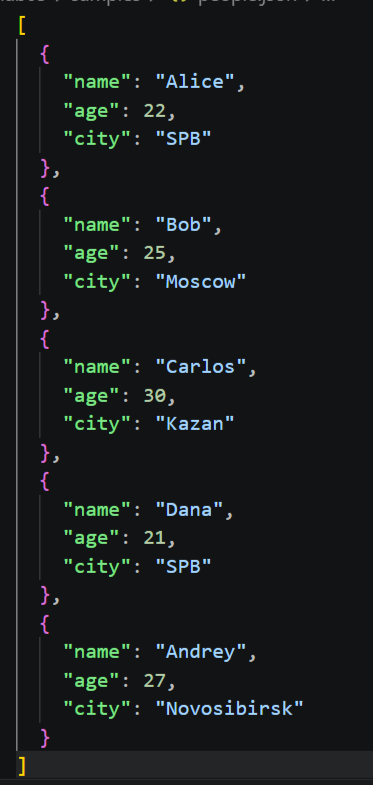
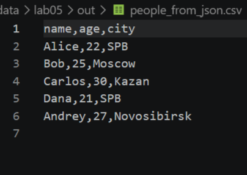
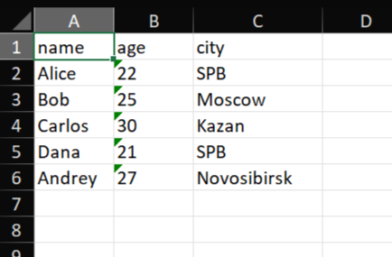

# python_labs
# Лабораторная работа 5

## Задание А
## Функция json_to_csv

``` python
def json_to_csv(json_path: str, csv_path: str) -> None:
    ''' Преобразует JSON со списком словарей в CSV
    Отсутствующие поля заполняются пустой строкой
    
    Raises:
        FileNotFoundError: входного файла нет
        ValueError: не то расширение, пустой файл или не список словарей
    '''
    json_path=Path(json_path)
    csv_path=Path(csv_path)
 
    if json_path.suffix.lower() != ".json" or csv_path.suffix.lower() != ".csv":
        raise ValueError("Неверный тип файлов")
    if not json_path.is_file():
        raise FileNotFoundError("Файл не найден")

    with json_path.open(encoding="utf-8") as f:
        try:
            data = json.load(f)
        except json.JSONDecodeError:
            raise ValueError("JSON пустой или содержит некорректные данные")
    
    if not isinstance(data, list) or not data:
        raise ValueError("Пустой JSON или неподдерживаемая структура (ожидался список)")
    if not all(isinstance(item, dict) for item in data):
        raise ValueError("Все элементы списка JSON должны быть словарями")

    columns = []
    for item in data:
        for key in item:
            if key not in columns:
                columns.append(key)
    
    if not columns:
        raise ValueError("В JSON нет столбцов")

    ensure_parent_dir(csv_path)
    with csv_path.open("w", newline="", encoding="utf-8") as f:
        writer = csv.DictWriter(f, fieldnames=columns)
        writer.writeheader()
        writer.writerows(data)
```
Было
 
 

 Стало



## Функция csv_to_json

``` python
def csv_to_json(csv_path: str, json_path: str) -> None:
    '''Преобразовать CSV в JSON со списком словарей
    Первая строка в CSV - заголовок

    Raises:
        FileNotFoundError: входного файла нет
        ValueError: не то расширение, нет заголовка или нет ни одной записи
    '''

    csv_path = Path(csv_path)
    json_path = Path(json_path)

    if csv_path.suffix.lower() != ".csv" or json_path.suffix.lower() != ".json":
        raise ValueError("Неверный тип файлов")

    if not csv_path.is_file():
        raise FileNotFoundError("Файл не найден")

    with csv_path.open("r", newline="", encoding="utf-8") as f:
        reader = csv.DictReader(f)

        if not reader.fieldnames:
            raise ValueError("CSV пустой или отсутствует заголовок")

        data = list(reader)

    if not data:
        raise ValueError("CSV не содержит данных")

    ensure_parent_dir(json_path)

    with json_path.open("w", encoding="utf-8") as f:
        json.dump(data, f, ensure_ascii=False, indent=2)

```
Было


Стало


## Задание В
## Функция csv_to_xlsx
``` python
def csv_to_xlsx(csv_path: str, xlsx_path: str) -> None:
    '''Преобразует CSV-файл в Excel-файл'''

    csv_path = Path(csv_path)
    xlsx_path = Path(xlsx_path)

    if csv_path.suffix.lower() != ".csv" or xlsx_path.suffix.lower() != ".xlsx":
        raise ValueError("Неверный тип файлов")

    if not csv_path.is_file():
        raise FileNotFoundError("Файл не найден")

    with csv_path.open("r", newline="", encoding="utf-8") as f:
        reader = csv.reader(f)
        data = list(reader)

    if not data or not data[0]:
        raise ValueError("CSV пустой или отсутствует заголовок")

    if not any(row for row in data[1:]):
        raise ValueError("CSV не содержит данных")

    wb = Workbook()
    ws = wb.active
    ws.title = "Sheet1"

    for row in data:
        ws.append(row)

    for column in ws.columns:
        max_length = 0

        for cell in column:
            if cell.value is not None:
                max_length = max(max_length, len(str(cell.value)))

        letter = get_column_letter(column[0].column)
        ws.column_dimensions[letter].width = max(8, max_length + 2)

    ensure_parent_dir(xlsx_path)
    wb.save(xlsx_path)
```
Было


Стало



