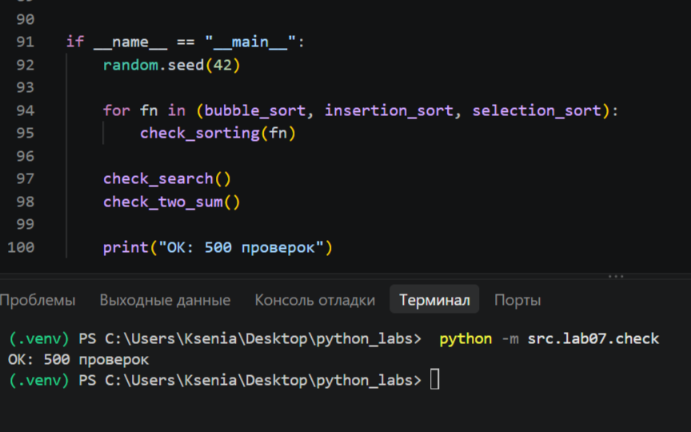
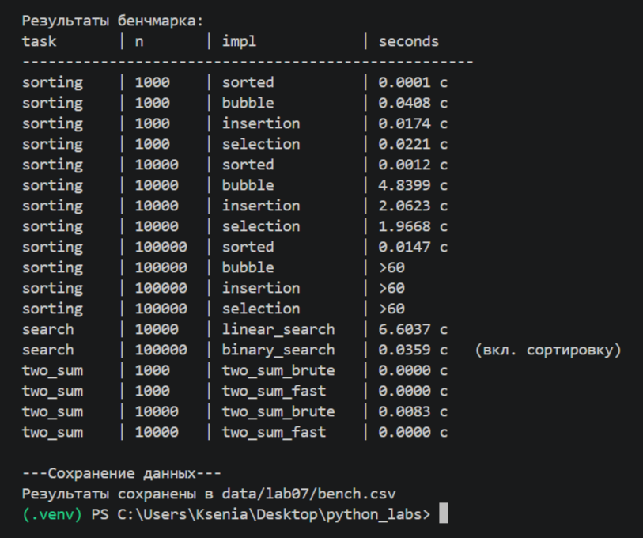

# python_labs
# Лабораторная работа 7— Поиск, сортировка и измерение времени.

## Структура лабораторной работы:

- `src/lab07/search.py` — алгоритмы поиска (`linear_search`, `binary_search`, `two_sum_brute`, `two_sum_fast`).
- `src/lab07/sorting.py` — алгоритмы сортировки (`bubble_sort`, `insertion_sort`, `selection_sort`).
- `src/lab07/check.py` — проверка алгоритмов на случайных данных (сравнение с эталоном).
- `src/lab07/bench.py` — замеры времени работы алгоритмов.

---

## Задание A:

### linear_search
``` python
def linear_search(nums: list[int], x: int) -> int:
    """Индекс первого вхождения x или -1.
 
    linear_search([4, 2, 7, 2], 2) -> 1
    linear_search([4, 2, 7, 2], 9) -> -1
    linear_search([], 1) -> -1
    """
    for i in range(len(nums)):
        if nums[i]==x:
            return i
    return -1
```
- Функция linear_search последовательно перебирает элементы списка и сравнивает их с искомым числом. Если число найдено, возвращается индекс его первого вхождения, иначе — -1. Временная сложность — O(n).
### binary_search
``` python
def binary_search(sorted_nums: list[int], x: int) -> int:
    """
    Индекс x в отсортированном по возрастанию списке или -1
    На неотсортированном списке результат не определён.
    Возвращает индекс найденного элемента или -1, если элемент отсутствует.

    binary_search([1, 3, 5, 7], 5) -> 2
    binary_search([1, 3, 5, 7], 4) -> -1
    binary_search([5], 5) -> 0
    binary_search([], 5) -> -1
    """
    lo=0
    hi=len(sorted_nums)-1
    while lo<=hi:
        mid=(lo+hi)//2
        if sorted_nums[mid]==x:
            return mid
        elif sorted_nums[mid]<x:
            lo=mid+1
        else:
            hi=mid-1
    return -1
```
- Функция binary_search выполняет поиск числа в отсортированном списке. На каждой итерации проверяется средний элемент и отбрасывается половина области поиска. Если число найдено, возвращается его индекс, иначе — -1. Временная сложность — O(log n).
### two_sum_brute
``` python
def two_sum_brute(nums, target):
    """Пара индексов (i, j), i < j, nums[i] + nums[j] == target, или None.
 
    two_sum_brute([2, 7, 11, 15], 9) -> (0, 1)
    two_sum_brute([1, 2], 10) -> None
    """
    for i in range(len(nums)):
        for j in range(i + 1, len(nums)):
            if nums[i] + nums[j] == target:
                return (i, j)

    return None
```
- Функция two_sum_brute с помощью двух вложенных циклов перебирает возможные пары элементов списка и проверяет их сумму. Если сумма равна target, возвращаются индексы этих элементов, иначе — None. Временная сложность — O(n²).

### two_sum_fast
``` python
def two_sum_fast(nums: list[int], target: int) -> tuple[int, int] | None:
    """То же, что two_sum_brute, но за один проход со словарём 

    two_sum_fast([2, 7, 11, 15], 9) -> (0, 1)
    """
    seen = {}       # значение -> его индекс
    for i, x in enumerate(nums):
        need = target - x 
        if need in seen:
            return (seen[need], i)
        seen[x] = i
    return None
```
- Функция two_sum_fast проходит по списку один раз и сохраняет просмотренные числа и их индексы в словаре. Для каждого элемента вычисляется недостающее до target число и проверяется его наличие в словаре. Если пара найдена, возвращаются её индексы, иначе — None. Средняя временная сложность — O(n).
---

## Задание B:

### bubble_sort
``` python 
def bubble_sort(nums):
    """Новый список, отсортированный по возрастанию. Исходный не меняется.
 
    bubble_sort([3, 1, 2]) -> [1, 2, 3]
    bubble_sort([2, 2, 1]) -> [1, 2, 2]
    bubble_sort([]) -> []
    """
    nums = list(nums)
    n = len(nums)

    for i in range(n):
        swapped = False

        for j in range(n - i - 1):
            if nums[j] > nums[j + 1]:
                nums[j], nums[j + 1] = nums[j + 1], nums[j]
                swapped = True

        if not swapped:
            break

    return nums
```
- Функция bubble_sort() сортирует список по возрастанию, сравнивая соседние элементы. Если левый элемент больше правого, они меняются местами. После каждого прохода наибольший элемент оказывается в конце неотсортированной части списка. Если за проход не произошло ни одного обмена, сортировка завершается.

### insertion_sort
``` python 
def insertion_sort(nums: list[int]) -> list[int]:
    """Сортирует список методом вставок.
    Создает и возвращает новый отсортированный список, не меняя исходный.
    Принимает исходный, возвращает новый.
    """
    nums = list(nums)

    for i in range(1, len(nums)):
        key = nums[i]
        j = i - 1

        while j >= 0 and nums[j] > key:
            nums[j + 1] = nums[j]
            j -= 1

        nums[j + 1] = key

    return nums
```
- Функция insertion_sort() перебирает элементы списка, начиная со второго. Текущий элемент сохраняется в переменную key, а элементы, которые больше него, сдвигаются вправо. Затем сохранённый элемент вставляется на правильное место. Процесс повторяется до полной сортировки списка.

### selection_sort
``` python 
def selection_sort(nums: list[int]) -> list[int]:
    """Сортирует список методом выбора.
    Создает и возвращает новый отсортированный список, не изменяя исходный.
    Принимает исходный, возвращает новый.
    """
    nums = list(nums)
    n = len(nums)

    for i in range(n):
        min_index = i

        for j in range(i + 1, n):
            if nums[j] < nums[min_index]:
                min_index = j

        nums[i], nums[min_index] = nums[min_index], nums[i]

    return nums
```
- Функция selection_sort() находит минимальный элемент в неотсортированной части списка и запоминает его индекс в переменной min_index. После завершения поиска минимальный элемент меняется местами с текущим. Таким образом, отсортированная часть списка постепенно увеличивается.

---

## Задание C:

### check_sorting

``` python
def check_sorting(fn, trials=100):
    for _ in range(trials):
        n = random.randint(0, 50)
        nums = [random.randint(-100, 100) for _ in range(n)]
        original = nums.copy()
        result = fn(nums)
        assert result == sorted(nums), f"{fn.__name__} ошиблась на {nums}: {result}"
        assert nums == original, f"{fn.__name__} изменила исходный список"
```
- Функция проверяет корректность работы алгоритмов сортировки. На каждой итерации создаётся случайный список, который передаётся в проверяемую функцию. Полученный результат сравнивается со встроенной функцией sorted(). Дополнительно проверяется, что исходный список не был изменён.

### heck_search

``` python 
def check_search(trials=100):
    for _ in range(trials):
        n = random.randint(0, 50)
        nums = [random.randint(-100, 100) for _ in range(n)]

        # Линейный поиск
        if nums:
            x = random.choice(nums)
            assert linear_search(nums, x) == nums.index(x), \
                f"Ошибка линейного поиска: {nums}, x={x}"

        # Проверяем отсутствующее число
        x = 101
        try:
            expected = nums.index(x)
        except ValueError:
            expected = -1

        assert linear_search(nums, x) == expected, \
            f"Ошибка линейного поиска: {nums}, x={x}"

        # Бинарный поиск работает с отсортированным списком
        nums_sorted = sorted(nums)

        # Проверяем первый, последний и случайный элементы
        if nums_sorted:
            for x in (nums_sorted[0], nums_sorted[-1],
                      random.choice(nums_sorted)):
                index = binary_search(nums_sorted, x)

                assert 0 <= index < len(nums_sorted), \
                    f"Неверный индекс: {index}, список: {nums_sorted}, x={x}"

                assert nums_sorted[index] == x, \
                    f"Ошибка бинарного поиска: {nums_sorted}, x={x}"

        # Проверяем отсутствующее число
        assert binary_search(nums_sorted, 101) == -1, \
            f"Ошибка бинарного поиска: {nums_sorted}, x=101"
```
- Функция проверяет работу линейного и бинарного поиска на случайно сгенерированных списках. Результат линейного поиска сравнивается с методом index(). Для бинарного поиска список предварительно сортируется, после чего проверяется поиск первого, последнего и случайного элементов. Также оба алгоритма проверяются на поиск отсутствующего числа.

### check_two_sum

``` python 
def check_two_sum(trials=100):
    for _ in range(trials):
        n = random.randint(0, 50)
        nums = [random.randint(-100, 100) for _ in range(n)]
        target = random.randint(-200, 200)

        res_brute = two_sum_brute(nums, target)
        res_fast = two_sum_fast(nums, target)

        # Если один алгоритм не нашёл пару, второй тоже не должен
        assert (res_brute is None) == (res_fast is None), \
            f"Результаты различаются: {nums}, target={target}"

        # Проверяем правильность найденных пар
        for result in (res_brute, res_fast):
            if result is not None:
                i, j = result

                assert 0 <= i < j < len(nums), \
                    f"Неверные индексы: {nums}, result={result}"

                assert nums[i] + nums[j] == target, \
                    f"Неверная сумма: {nums}, target={target}, result={result}"
``` 
- Функция проверяет алгоритм полного перебора и оптимизированный алгоритм решения задачи Two Sum. Генерируется случайный список чисел и целевая сумма target. Затем проверяется, согласны ли оба алгоритма в наличии подходящей пары, корректны ли возвращаемые индексы и равна ли сумма найденных элементов заданному значению.




## Задание D:
- Замеры выполнены через модуль timeit при фиксированном random.seed(42). Исходные данные сохранены в data/lab07/bench.csv.


--- 
1. По результатам бенчмарка видно, что при увеличении размера массива в 10 раз время работы пузырьковой сортировки увеличилось примерно в 119 раз (с 0.0408 до 4.8399 с), так как её временная сложность составляет O(n²). Встроенная функция sorted замедлилась всего в 12 раз благодаря сложности O(n log n). При размере массива 100000 элементов пузырьковая сортировка, сортировка вставками и выбором заняли более 60 секунд, тогда как sorted справилась за 0.0147 с.

2. Бинарный поиск работает корректно только на отсортированных данных, поскольку на каждом шаге отбрасывает половину области поиска. Предварительная сортировка окупается при большом количестве поисковых запросов к одному массиву. По результатам бенчмарка линейный поиск занял 6.6037 с, а бинарный — 0.0359 с с учётом сортировки. Окупается она только тогда, когда запросов много (как в нашем случае — 10 000). Для 1-2 запросов быстрее просто пройтись по списку циклом.