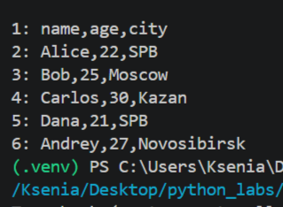
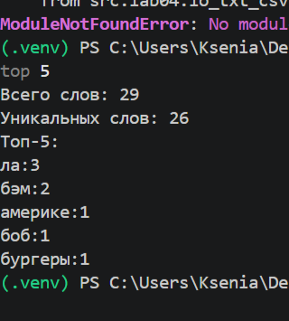
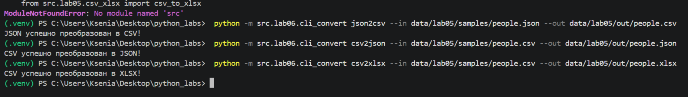
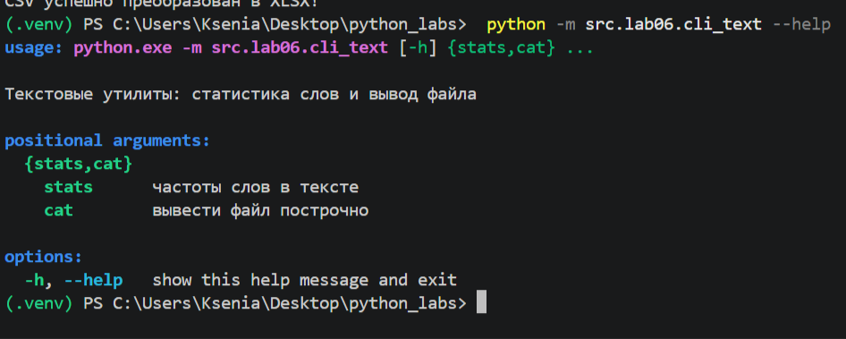

# python_labs
# Лабораторная работа 6

Команды запускаем из корня проекта. Используем argparse, стандартную библиотеку и функции из предыдущих лабораторных. Текстовые файлы читаем в UTF-8.

## Задание А

Утилиты


stats --> stats --input <путь> [--top N] (считает слова, выводит Топ-N)


cat --> cat --input <путь> [-n](выводит файл построчно, -n нумерует строки)

``` python 
def stats(path: str, top: int) -> None:
    '''Напечатать число слов и топ самых частых'''

    tokens = tokenize(normalize(read_text(path)))
    freq = count_freq(tokens)

    print(f"Всего слов: {len(tokens)}")
    print(f"Уникальных слов: {len(freq)}")
    print("Топ-5:")
    for word, count in top_n(freq,top):
        print(f"{word}:{count}")
```

``` python 
def cat(path: str, numbered: bool) -> None:
    """Подкоманда cat: выводит содержимое файла построчно.
    Если указан флаг -n - перед каждой строкой печатается её номер.
    """
    lines = read_text(path).splitlines()
    for number, line in enumerate(lines, start=1):
        if numbered:
            print(f"{number}: {line}")
        else:
            print(line)
```
## Выводы

 

  

## Задание В

Утилиты 


json2csv --> --in, --out (JSON -> CSV)


csv2json --> --in, --out (CSV -> JSON)


csv2xlsx -->--in, --out (CSV -> XLSX)



## Справка --help
Это инструкция по эксплуатации программы, которая генерируется автоматически



